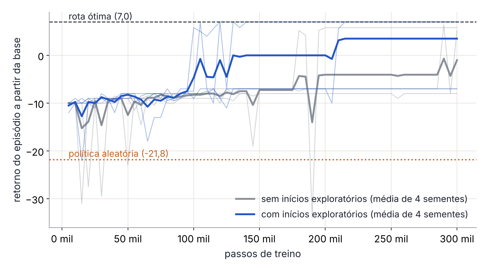
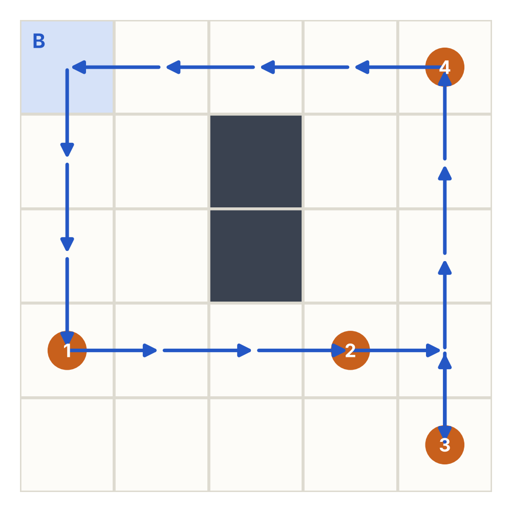

# Desafio 2 — DQN no robô aspirador

Treinamos um DQN (Stable-Baselines3, como na atividade de DQN da disciplina) no problema do Desafio 1, sem mudar o MDP: grade 5×5, base em (0,0), obstáculos em (2,1) e (2,2), sujeira em (4,0), (0,3), (3,3) e (4,4), bateria 20 e as mesmas recompensas, com γ = 0,95.

## Arquivos

| Arquivo | O que faz |
|---|---|
| `ambiente.py` | Ambiente no formato Gymnasium (`RoboAspiradorEnv`) |
| `treinar_dqn.py` | Treina o DQN e salva o melhor modelo em `resultados/<nome>/` |
| `avaliar.py` | Tabela com todos os modelos treinados, ou um episódio passo a passo (`--mostrar`) |
| `graficos.py` | Gera `resultados/curva_aprendizado.png` e `resultados/trajetoria.png` |
| `verificar_otimo.py` | Calcula a política ótima exata por iteração de valor, para conferir a rota do DQN |

## Como rodar

```bash
python -m venv .venv
source .venv/bin/activate
pip install -r requirements.txt

python avaliar.py --mostrar     # mostra o robô treinado limpando (usa o modelo já salvo)
python avaliar.py               # tabela de resultados
python treinar_dqn.py --seed 0  # treina de novo (300 mil passos, alguns minutos na CPU)
python graficos.py
python verificar_otimo.py       # política ótima exata, para comparar com o DQN
```

## Configuração

- Observação para a rede: `(x/4, y/4, b/20, d1, d2, d3, d4)`, 7 valores entre 0 e 1 (o mesmo estado markoviano do Desafio 1, normalizado).
- Rede: MLP 7 → 64 → 64 → 5 (um Q por ação).
- Replay buffer de 50 mil transições, lote de 64, rede alvo atualizada a cada 500 passos, taxa de aprendizado 1e-3.
- ε-greedy: ε cai de 1,0 para 0,05 nos primeiros 30% do treino.
- 300 mil passos de treino. Episódios truncados em 100 passos.
- A cada 5 mil passos a política gulosa é avaliada começando da base, e guardamos o melhor modelo (`EvalCallback`).

**Inícios exploratórios:** na primeira versão o DQN aprendia a limpar 2 ou 3 sujeiras e depois ficava rondando a base, para nunca levar o −10 da bateria. Isso é um ótimo local: ele quase nunca chegava, por acaso, a uma situação em que só faltava a sujeira do canto. Por isso, no treino, metade dos episódios começa numa posição aleatória e com parte da sujeira já limpa. A avaliação sempre começa na base, com tudo sujo.

## Resultados

Avaliação a partir da base, com as 4 sujeiras (`python avaliar.py`). Os números são do melhor modelo salvo em cada treino:

| Política | Retorno | Sujeiras limpas | Passos | Sucesso |
|---|---|---|---|---|
| Aleatória (média de 100 episódios) | −21,8 | 0,4 | 37,5 | 0% |
| DQN sem inícios exploratórios (4 sementes) | 6,4 · −7,0 · −8,0 · 5,8 | 4 · 3 · 2 · 4 | 26 · 100 · 100 · 32 | 2 de 4 |
| DQN com inícios exploratórios (4 sementes) | 7,0 · 7,0 · 7,0 · −7,0 | 4 · 4 · 4 · 3 | 20 · 20 · 20 · 100 | 3 de 4 |

- A rota ótima tem 20 passos e retorno 7,0: limpa as 4 sujeiras e chega à base exatamente quando a bateria acabaria. Com inícios exploratórios, 3 das 4 sementes encontraram essa rota.
- Conferimos com iteração de valor (`python verificar_otimo.py`), que usa o modelo do ambiente e calcula a política ótima exata: ela tem 20 ações, retorno 7,0, e limpa na mesma ordem que o DQN.
- Com inícios exploratórios, o modelo do fim do treino dá o mesmo resultado que o melhor modelo salvo nas 4 sementes. Sem inícios, continua 2 de 4, mas a semente 0 termina numa rota de 33 passos em vez de 26.
- Sem inícios exploratórios, só 2 sementes completaram a tarefa, e por rotas mais longas (26 e 32 passos, voltando à base para recarregar no meio).
- As sementes que falham ficam no ótimo local: limpam 2 ou 3 sujeiras e rondam a base até o limite de 100 passos.





Rota aprendida (semente 0): base → (0,3) → (3,3) → (4,4) → (4,0) → base.
